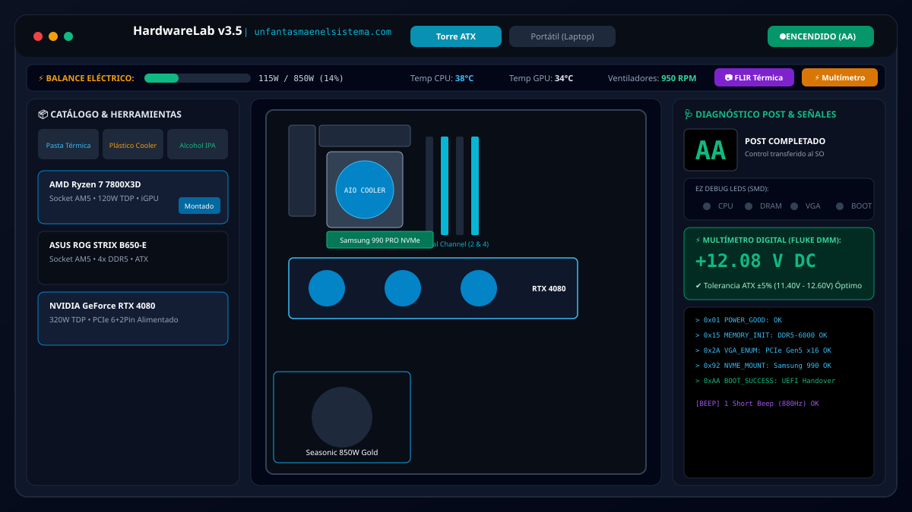
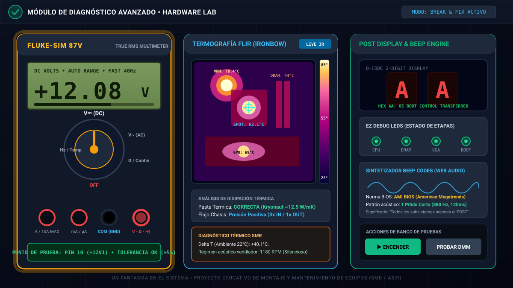
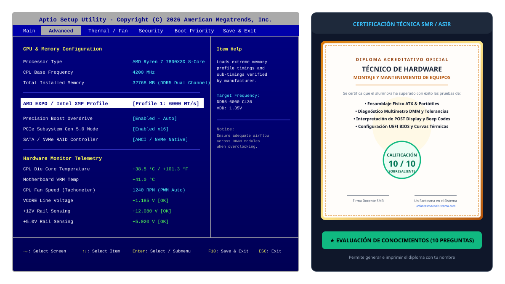

# 🖥️ Simulador de Hardware & Taller de Diagnóstico PC

<div align="center">

<a href="https://www.unfantasmaenelsistema.com/" target="_blank" rel="noopener noreferrer">
  
</a>

### Plataforma Educativa Interactiva de Montaje y Mantenimiento de Equipos Informáticos
**Desarrollado para Formación Profesional (SMR / ASIR), Laboratorios Universitarios y Técnicos de Soporte**

[](https://www.unfantasmaenelsistema.com/)
[](https://www.unfantasmaenelsistema.com/)
[](LICENSE)
[](https://developer.mozilla.org/es/docs/Web/API/Web_Audio_API)

</div>

---

## 📸 Vistas y Capturas del Sistema

### 1. Banco de Trabajo y Ensamblaje Físico (Torre ATX & Portátil Laptop)
Placa base con componentes interactivos, catálogo clasificado por slots, telemetría térmica/eléctrica en vivo y panel de instrumentos.



---

### 2. Estación de Diagnóstico: Multímetro Digital DMM, Termografía FLIR y Display POST
Medición de voltajes reales con rangos de tolerancia ATX, mapa de calor infrarrojo (Ironbow) con detección de hotspots en VRM/CPU/GPU, visualizador de 7 segmentos de 2 dígitos y sintetizador de pitidos BIOS.



---

### 3. Simulador UEFI BIOS Aptio Setup Utility & Evaluación SMR / ASIR
Configuración interactiva de perfiles XMP/EXPO, telemetría de voltajes y examen teórico-práctico de 10 preguntas con emisión de diploma oficial descargable.



---

## 🎯 ¿Qué es esta aplicación?

Es un **laboratorio virtual integral de hardware** diseñado tanto para estudiantes de informática (Ciclos Formativos de Grado Medio en **Sistemas Microinformáticos y Redes - SMR** y Grado Superior en **Administración de Sistemas Informáticos en Red - ASIR**) como para entusiastas y técnicos de servicio de asistencia.

La aplicación permite practicar todo el ciclo de vida de un equipo informático:
1. **Ensamblaje físico guiado y sin riesgos.**
2. **Validación algorítmica de compatibilidad eléctrica, térmica y de formatos.**
3. **Puesta en marcha con secuencia POST real y sonido de la BIOS mediante Web Audio API.**
4. **Localización de averías con herramientas profesionales (DMM, cámara térmica, códigos POST y LEDs de estado).**
5. **Configuración del firmware UEFI/BIOS.**
6. **Evaluación de conocimientos con diploma acreditativo personalizable.**

---

## ✨ Características Principales

### 🛠️ 1. Simulador de Montaje Interactivo (Dual-Device)
- **Torre ATX de Chasis Abierto:**
  - Socket CPU con pestaña de retención y triángulo dorado de alineación.
  - Aplicación de compuesto térmico y montaje de Cooler de aire o Refrigeración Líquida (AIO).
  - Configuración de memoria RAM en Dual Channel (Slots DDR 2 y 4 preferentes).
  - Almacenamiento SSD M.2 NVMe PCIe 4.0/5.0 con tornillo y disipador.
  - Tarjeta gráfica dedicada (GPU) en ranura PCIe 5.0 x16 con cierre mecánico.
  - Fuente de alimentación modular con conexionado individual de cableado ATX 24 pines, EPS 8 pines (+12V CPU) y PCIe 6+2 pines.
  - Conexión del Front Panel (Power SW, Reset SW, Power LED, HDD LED).
- **Portátil / Laptop (Chasis Inferior Abierto):**
  - **Protocolo de seguridad obligatorio:** Desconexión previa de la batería interna antes de cualquier manipulación de componentes.
  - Módulos SO-DIMM RAM con inserción en ángulo de 30° y cierre por presión.
  - Tarjeta Wi-Fi / Bluetooth M.2 con conexión de cableado coaxial de antena (Main y Auxiliar).
  - Módulo térmico de cobre con apriete de tornillos numerados en cruz (1 ➔ 2 ➔ 3 ➔ 4) para reparto uniforme de presión sobre el die de silicio.

---

### ⚡ 2. Motor de Compatibilidad en Tiempo Real
El sistema ejecuta un análisis cruzado instantáneo de la configuración montada y avisa ante anomalías:
* **Incompatibilidad de Socket:** Detección de combinaciones erróneas (ej. Intel LGA1700 montado sobre AMD AM5 / AM4).
* **Generación de Memoria:** Validación de slots DDR4 frente a DDR5 y módulos DIMM vs. SO-DIMM.
* **Sobrecarga de Fuente (Power Budgeting):** Sumatorio de TDP de CPU, GPU, chipset y periféricos con margen de seguridad del 20%. Alerta si la fuente no entrega los vatios requeridos.
* **Cuello de Botella Térmico:** Detección de procesadores de alto TDP (>120W) sin compuesto térmico o con disipadores pasivos insuficientes.
* **Factor de Forma:** Verificación de dimensiones de placa base contra bahías del chasis.

---

### 🔊 3. Secuencia POST, Display Hexadecimal y Sintetizador de Beep Codes
- **Display Q-Code de 2 Dígitos Hexadecimales (7 Segmentos):**
  - Muestra la progresión de estados POST (`15` Pre-memoria, `55` Error RAM, `d6` Error GPU, `A2` IDE/SATA Detect, `AA` Éxito total y cesión al SO).
- **EZ Debug LEDs (4 Fases SMD):**
  - LEDs de diagnóstico rápido en placa: `CPU`, `DRAM`, `VGA` y `BOOT`.
- **Sintetizador de Pitidos BIOS con Web Audio API Nativo:**
  - Generación de audio analítico en tiempo real (ondas cuadradas con armónicos a 880 Hz - 1000 Hz) **sin archivos de audio externos**.
  - Soporte de 3 tablas de BIOS históricas y actuales: **AMI BIOS**, **Award BIOS** y **Phoenix BIOS**.
  - Emulación de pitido único de OK, bucle infinito de memoria, código 1 largo + 2 cortos de GPU y sirena de alta/baja frecuencia por sobrecalentamiento.

---

### 🧪 4. Módulo de Diagnóstico Avanzado & Instrumentación de Laboratorio
- **Multímetro Digital DMM (Emulación Fluke True RMS):**
  - Sonda interactiva sobre los 9 pines críticos del conector ATX de 24 pines (+12V1, +12V2, +5V, +3.3V, +5VSB Standby, PWR_OK / PG, PS_ON#, -12V y GND).
  - Comprobación automática contra la **norma ATX 3.0** (Tolerancias ±5% en líneas principales y ±10% en carril negativo).
- **Cámara Termográfica FLIR (Paleta Ironbow):**
  - Mapa térmico interactivo que refleja la carga del procesador y los mosfets de la etapa de potencia VRM.
  - Detección visual de gradientes térmicos: Azul profundo (25°C) ➔ Magenta ➔ Naranja ➔ Blanco incandescente (Hotspot a 85°C+).
- **Kit de Taller y Mantenimiento:**
  - Pulsera antiestática ESD conectada a tierra para evitar descargas electrostáticas destructivas.
  - Bote de Alcohol Isopropílico (IPA 99.9%) con paño de microfibra para limpieza de IHS.
  - Jeringa dosificadora de pasta térmica de alto rendimiento (Kryonaut ~12.5 W/mK).

---

### 💻 5. Simulador UEFI BIOS Aptio Setup Utility
- Emulación fiel en pantalla completa del entorno de firmware con control de teclado (**← → ↑ ↓, Enter, F10, ESC**):
  - **Pestaña Main:** Datos del procesador, frecuencia, cantidad de memoria y versión de BIOS.
  - **Pestaña Advanced:** Activación de perfiles de memoria de alto rendimiento **Intel XMP / AMD EXPO (DDR5-6000)** y modos PCIe Gen 5.0.
  - **Pestaña Thermal & Hardware Monitor:** Monitorización en tiempo real de voltajes VCORE, velocidad de ventilador por tacómetro PWM y temperatura de silicio.
  - **Pestaña Boot Priority:** Selección de dispositivo de arranque (NVMe SSD vs. Memoria USB UEFI).

---

### 🩺 6. Modo Taller de Averías (Break & Fix / Retos Técnicos)
Generador de incidentes de soporte técnico real con piezas averiadas ocultas:
1. **Caso 1: "La pantalla negra del novato":** Código POST `55`, 3 pitidos cortos en AMI BIOS; falso contacto o módulo DDR no asentado en el banco correspondiente.
2. **Caso 2: "El apagón por sobretemperatura":** El equipo enciende pero se apaga a los 15 segundos con thermal throttling; ausencia de pasta térmica o plástico protector de la base del disipador no retirado.
3. **Caso 3: "Reinicios bajo carga pesada":** Fuente genérica defectuosa en el rail de +12V que sufre caídas de tensión al superar los 300W de consumo de GPU.
4. **Caso 4: "El bucle infinito de BIOS / No Boot":** Disco duro no inicializado o fallo del bus SATA/NVMe; código POST `A2`.

---

### 🎓 7. Evaluación de Conocimientos y Certificación SMR / ASIR
- Batería de 10 preguntas tipo test sobre normas ATX, arquitectura x86, refrigeración y procedimientos de seguridad en taller.
- Corrección inmediata con justificación pedagógica en cada respuesta.
- Generación de **Diploma Oficial de Técnico de Hardware**, sellado por el portal *Un Fantasma en el Sistema*, con nombre del alumno/a, fecha y calificación, listo para imprimir o guardar en PDF.

---

## 📋 Tablas de Referencia Rápida para Técnicos

### 1. Códigos POST Hexadecimales Comunes (Display de 2 Dígitos)

| Código Hex | Significado Técnico | Procedimiento de Resolución |
| :---: | :--- | :--- |
| **`00` / `FF`** | Error grave de CPU o microcódigo corrupto | Verificar pines del socket, alimentación EPS de 8 pines o actualizar BIOS con flashback. |
| **`15` - `19`** | Inicialización del controlador de memoria | Proceso normal de entrenamiento de memoria (Memory Training). Esperar unos segundos. |
| **`53` / `55`** | Memoria RAM no detectada o incompatible | Reasentar módulos en slots A2/B2 (2 y 4), limpiar contactos con IPA o probar módulo a módulo. |
| **`b2` / `d6`** | Fallo de GPU / Sin salida de vídeo | Comprobar cable PCIe 6+2 pines de la gráfica, asentar ranura PCIe x16 o revisar cable DisplayPort/HDMI. |
| **`99` / `A2`** | Dispositivos de arranque no encontrados | Verificar alimentación SATA, conexión de M.2 NVMe o configuración de partición GPT/UEFI en BIOS. |
| **`AA`** | **POST Exitoso** | El sistema ha cedido el control de arranque al cargador del sistema operativo (OS Boot Loader). |

---

### 2. Patrones Acústicos de la BIOS (AMI BIOS Beep Codes)

| Patrón Acústico | Fallo Diagnosticado | Acción Correctiva |
| :--- | :--- | :--- |
| **1 pitido corto** | **POST OK** | Equipo listo. Operación normal. |
| **1 largo continuo** | Fallo de refresco o suministro DRAM | Reinsertar RAM o comprobar carril +3.3V/+1.2V. |
| **3 pitidos cortos** | Error en los primeros 64KB de RAM | Módulo de memoria defectuoso o slot dañado. |
| **1 largo + 2 cortos** | Fallo en subsistema de vídeo (GPU) | Comprobar GPU dedicada, alimentación PCIe o monitor. |
| **1 largo + 3 cortos** | Error de memoria convencional / DAC de vídeo | Tarjeta gráfica incompatible o VRAM defectuosa. |
| **Sirena aguda/grave** | Sobrecalentamiento crítico de CPU | Apagado inmediato. Inspeccionar anclaje de cooler y compuesto térmico. |

---

### 3. Tolerancias Eléctricas Oficiales ATX (ATX12V 3.0 / EPS12V)

| Carril (Rail) | Tensión Nominal | Rango Mínimo Permitido | Rango Máximo Permitido | Tolerancia |
| :--- | :---: | :---: | :---: | :---: |
| **+12V1 / +12V2** | +12.00 V | **+11.40 V** | **+12.60 V** | **±5%** |
| **+5.0V** | +5.00 V | **+4.75 V** | **+5.25 V** | **±5%** |
| **+3.3V** | +3.30 V | **+3.14 V** | **+3.47 V** | **±5%** |
| **+5VSB (Standby)**| +5.00 V | **+4.75 V** | **+5.25 V** | **±5%** |
| **-12.0V** | -12.00 V | **-10.80 V** | **-13.20 V** | **±10%** |
| **PWR_OK (Power Good)** | +5.00 V | Señal TTL activa (> +2.4V) entre 100ms y 500ms tras encendido | |

---

## 🚀 Puesta en Marcha e Instalación

La aplicación está diseñada para tener **cero barreras de entrada**. Puedes ejecutarla de forma autónoma sin instalar herramientas de compilación, o bien servirla en un entorno de desarrollo web moderno.

### Opción A: Ejecución Directa (Sin dependencias ni Node.js)
El archivo `index.html` es completamente autosuficiente:
1. Clona o descarga este repositorio:
   ```bash
   git clone https://github.com/tu-usuario/simulador-hardware-pc.git
   ```
2. Abre directamente el archivo `index.html` con doble clic en tu navegador web preferido (Google Chrome, Mozilla Firefox, Microsoft Edge, Safari u Opera).
3. ¡Listo para usar en el aula o en tu taller!

---

### Opción B: Entorno de Desarrollo con Node.js / Vite
Si deseas modificar el código fuente con soporte de TypeScript y servidor de desarrollo local:

1. Clona el repositorio e instala los paquetes:
   ```bash
   git clone https://github.com/tu-usuario/simulador-hardware-pc.git
   cd simulador-hardware-pc
   npm install
   ```

2. Arranca el servidor de desarrollo local:
   ```bash
   npm run dev
   ```
   Abre tu navegador en `http://localhost:3000`.

3. Compila la versión de producción optimizada:
   ```bash
   npm run build
   ```
   Los archivos estáticos listos para producción se generarán en la carpeta `dist/`.

---

### Opción C: Despliegue en GitHub Pages (1 Clic)
1. Ve a los **Settings** de tu repositorio en GitHub.
2. Accede a la pestaña **Pages** en el menú izquierdo.
3. En **Source**, selecciona `Deploy from a branch` ➔ Rama `main` ➔ Carpeta `/ (root)`.
4. Guarda los cambios. Tu simulador estará online en segundos en `https://tu-usuario.github.io/simulador-hardware-pc/`.

---

## 📁 Estructura del Proyecto

```text
├── index.html                   # Aplicación principal completa (Single-File SPA con UI y Motores)
├── metadata.json                # Metadatos del proyecto y descriptores de configuración
├── package.json                 # Dependencias y scripts de construcción (Vite / Tailwind / TS)
├── tsconfig.json                # Configuración de TypeScript
├── vite.config.ts               # Configuración del bundler Vite
├── LICENSE                      # Licencia de código abierto MIT
├── README.md                    # Documentación técnica completa (esta guía)
├── public/
│   └── assets/
│       └── aistudio/
│           └── icono_81a3db5b.png # Logotipo oficial de Un Fantasma en el Sistema
└── docs/
    └── screenshots/             # Diagramas vectoriales y capturas de pantalla de la aplicación
        ├── workbench_preview.svg
        ├── diagnostics_dmm_preview.svg
        └── uefi_bios_preview.svg
```

---

## 🛡️ Principios Pedagógicos y Reglas de Taller Aplicadas

1. **La regla de oro del servicio técnico de portátiles:** Antes de tocar la placa, desconectar la batería para evitar cortocircuitos causados por caídas accidentales de tornillos o contactos de destornilladores.
2. **El apriete cruzado (Star Pattern / X-Pattern):** Los tornillos del disipador o del bloque de la CPU deben apretarse de forma equilibrada (siguiendo el orden 1-2-3-4) para evitar la fractura del sustrato de silicio y asegurar un reparto uniforme de la pasta térmica.
3. **El canal dual (Dual Channel):** El uso de dos canales independientes dobla el ancho de banda del bus de memoria (de 64 a 128 bits). En placas de 4 bancos, deben emplearse los slots 2 y 4 (A2 y B2) para minimizar las reflexiones de señal en los extremos de las pistas.
4. **La protección contra descargas electrostáticas (ESD):** La electricidad estática acumulada en el cuerpo humano (miles de voltios imperceptibles) puede perforar el óxido de puerta de los transistores MOSFET microscópicos sin dejar rastro visible exterior.

---

## 🤝 Créditos y Agradecimientos

Este simulador ha sido concebido y desarrollado con dedicación para la comunidad educativa y técnica por:

<div align="center">

### **Un Fantasma en el Sistema**
🌐 Sitio Web Oficial: [https://www.unfantasmaenelsistema.com/](https://www.unfantasmaenelsistema.com/)

*Divulgación tecnológica, arquitectura de sistemas, ciberseguridad y docencia informática.*

</div>

---

## 📄 Licencia

Este proyecto se distribuye bajo la licencia **MIT**. Eres libre de utilizarlo, modificarlo, integrarlo en aulas, colegios, institutos y centros de formación profesional siempre que se mantengan los créditos originales de autoría. Consulta el archivo [LICENSE](LICENSE) para más detalles.
