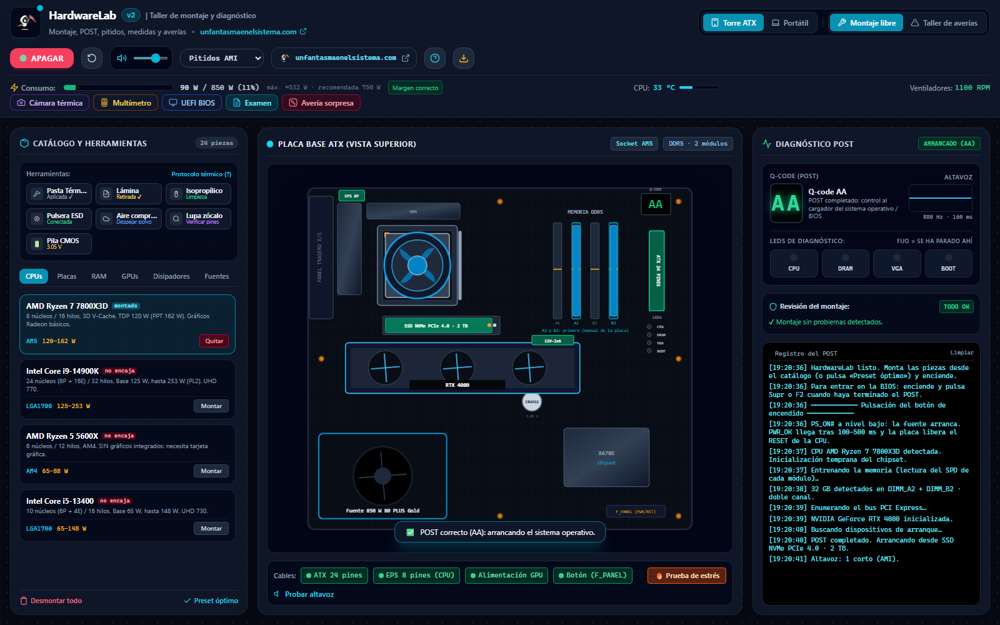
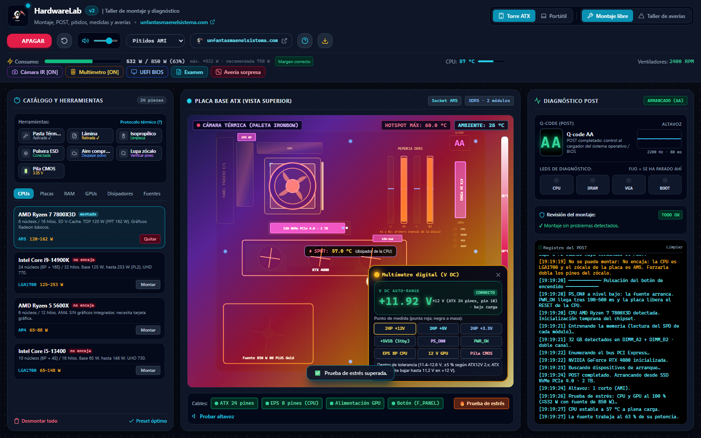
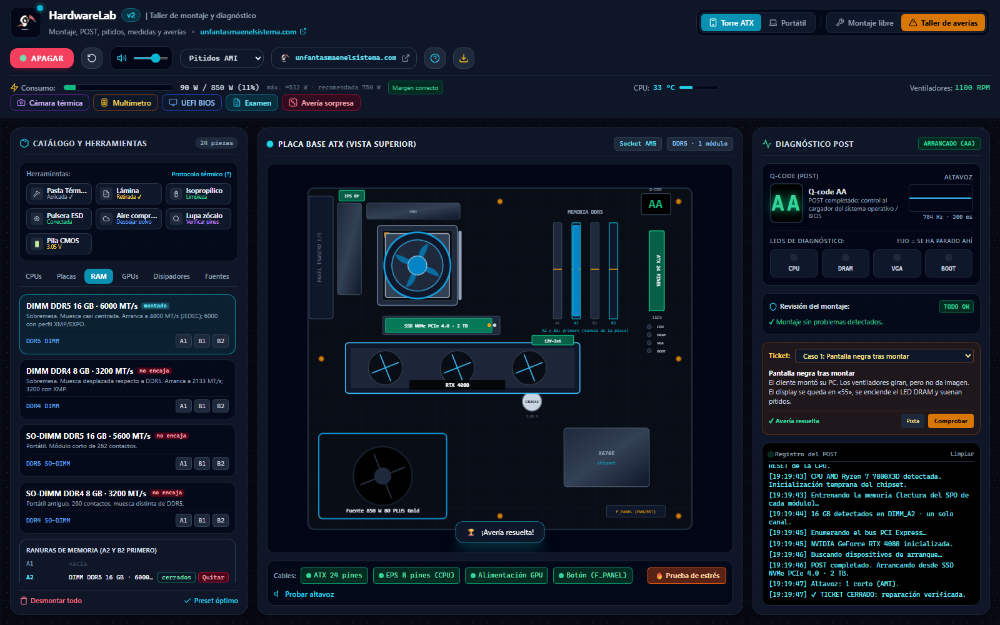
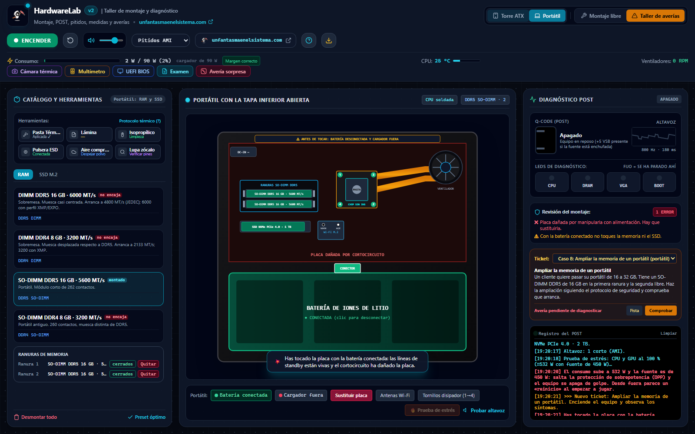

<p align="center">
  <a href="https://www.unfantasmaenelsistema.com"></a>
</p>

<h1 align="center">HardwareLab</h1>

<p align="center">
  <b>Taller de montaje y diagnóstico de PC en el navegador</b><br>
  Compatibilidad física real · POST con Q-codes, LEDs y pitidos · Multímetro · Cámara térmica · BIOS UEFI · Averías para resolver
</p>

<p align="center">
  <a href="https://unfantasmaenelsistema.github.io/HardwareLab/"><b>▶ Abrir el taller</b></a> ·
  <a href="#qué-hace">Qué hace</a> ·
  <a href="#averías">Averías</a> ·
  <a href="#de-dónde-salen-los-datos">Datos</a> ·
  <a href="#para-clase">Para clase</a> ·
  <a href="https://www.unfantasmaenelsistema.com">unfantasmaenelsistema.com</a> ·
  <a href="LICENSE">MIT</a>
</p>

<p align="center">
  
  
  
  
</p>

<p align="center">
  
</p>

Monta una torre o abre un portátil, enciéndelo y mira qué pasa: qué código marca el display, qué LED se queda encendido, cuántos pitidos suenan y qué dice el multímetro. Lo que no encaja en la realidad tampoco encaja aquí, y cada fallo tiene la causa y los síntomas que tendría en un taller de verdad. Funciona sin servidor, no envía nada a ningún sitio y se puede descargar en un único `.html` para usarlo sin conexión.

> [!NOTE]
> Es un simulador educativo. Las placas tienen display de Q-codes y LEDs de diagnóstico como las de gama media-alta; muchas placas básicas solo traen los LEDs o ni eso. Los códigos y pitidos varían según el fabricante: el manual de cada placa manda.

## Qué hace

- **Montaje con compatibilidad física**: una CPU AM4 no entra en un zócalo AM5, un módulo DDR4 no entra en una ranura DDR5 (la muesca es distinta) y un SO-DIMM no entra en una ranura de sobremesa. Si lo intentas, te dice por qué.
- **Memoria por ranuras**: eliges A1, A2, B1 o B2, y los pestillos pueden quedar abiertos (módulo sin asentar). El equipo te recomienda A2 y A2+B2, como los manuales.
- **Encendido con su secuencia real**: sin el ATX de 24 pines ni siquiera giran los ventiladores; sin el EPS de la CPU giran pero se queda en `00`, con el LED CPU y sin pitidos (sin procesador no hay firmware que pite); sin memoria, `55` y el LED DRAM; sin vídeo, `d6` y el LED VGA; sin disco, el POST acaba bien pero entra en la BIOS.
- **Pitidos AMI y Award** sintetizados con Web Audio, con las tablas clásicas de cada fabricante (memoria: 3 cortos en AMI, largos repetidos en Award; vídeo: 8 cortos en AMI, 1 largo + 2 cortos en Award).
- **Modelo térmico**: la temperatura depende del disipador, de la pasta y de la lámina protectora. Sin pasta, la CPU arranca pero limita su frecuencia bajo carga; con la lámina puesta se apaga al exigirle; sin disipador, en segundos.
- **Modelo eléctrico**: consumo en reposo y a plena carga, con la recomendación de fuente de NVIDIA o AMD para cada gráfica. Una fuente pequeña aguanta el escritorio pero corta por sobrepotencia (OPP) en la **prueba de estrés**.
- **Multímetro** en el conector ATX: +12 V, +5 V, +3,3 V, +5 VSB (presente aunque el equipo esté apagado), PS_ON# (alto apagado, bajo encendido), PWR_OK, EPS, alimentación de la gráfica y pila CMOS.
- **Cámara térmica**, **BIOS UEFI** (solo si el equipo ha pasado el POST; datos reales de la CPU y la memoria montadas, perfil EXPO o XMP según la plataforma) y **registro del arranque** paso a paso.
- **Portátil**: solo se cambian memoria y SSD; tocar la placa con la batería o el cargador conectados la daña; el disipador se aprieta en orden.
- **Examen de 10 preguntas** con las opciones barajadas y certificado de participación con tu nombre.

<p align="center">
  
</p>

## Averías

<p align="center">
  
</p>

En el modo **Taller de averías** cada ticket carga un equipo con un fallo. Hay que diagnosticarlo con los síntomas, repararlo y volver a encenderlo: la comprobación usa el arranque real, así que no vale tocar cosas al azar sin encender.

| Caso | Síntoma | Qué se aprende |
| :-- | :-- | :-- |
| Pantalla negra tras montar | `55`, LED DRAM, pitidos | Asentar la memoria (pestillos) |
| El conector olvidado | `00`, LED CPU, sin pitidos | El EPS alimenta la CPU; sin CPU no hay pitidos |
| Se apaga solo al encender | Ventiladores al máximo y apagado | Pasta y lámina protectora; throttling y THERMTRIP |
| Gráfica nueva, pantalla negra | `d6`, LED VGA, pitidos de vídeo | Alimentación auxiliar de la gráfica |
| Siempre entra en la BIOS | POST correcto, sin arranque | Sin disco arrancable |
| Se apaga al empezar a jugar | Bien en reposo, apagón bajo carga | Dimensionar la fuente (OPP) |
| Pierde la hora y la configuración | «CMOS checksum bad», pide F1 | Medir y cambiar la pila CR2032 |
| Ampliar la memoria de un portátil | — | Protocolo: batería y cargador fuera |

## De dónde salen los datos

- **CPU**: TDP y potencia máxima de los fabricantes (Ryzen 7 7800X3D: 120 W / PPT 162 W, Tjmax 89 °C; Core i9-14900K: 125 W / PL2 253 W; Core i5-13400: 65 / 148 W; Ryzen 5 5600X: 65 / 88 W, sin gráficos integrados).
- **Gráficas**: consumo y fuente recomendada por NVIDIA y AMD (RTX 4080: 320 W y 750 W, conector 16 pines 12VHPWR / 12V-2x6; RX 7800 XT: 263 W y 700 W, 2 × 8 pines).
- **Tensiones**: tolerancia de ±5 % de ATX12V 2.x (+12 V entre 11,40 y 12,60 V). ATX 3.x permite bajar +12 V hasta 11,2 V (−7 %) en casi todos los conectores. PWR_OK llega entre 100 y 500 ms después de estabilizar las tensiones.
- **Q-codes**: tabla de checkpoints de AMI Aptio que usan ASUS y otros (`55` memoria no instalada, `d6` sin salida de vídeo, `A2` dispositivos de arranque, `AA` control al sistema/BIOS).
- **Pitidos**: tablas clásicas de AMIBIOS y Award (memoria y vídeo).

El modelo térmico y eléctrico es una aproximación didáctica (temperatura proporcional a la potencia entre la capacidad del disipador y la calidad del contacto), no una simulación física. Sirve para que causa y síntoma vayan en la misma dirección que en la realidad.

## Para clase

- **Sin instalar nada**: abre el [enlace](https://unfantasmaenelsistema.github.io/HardwareLab/) o pulsa el botón de descarga y reparte el `.html`: funciona sin conexión.
- **Avería sorpresa** asigna un caso al azar: útil para que cada alumno diagnostique uno distinto y explique los síntomas antes de repararlo.
- El **registro del POST** se puede copiar para entregar el diagnóstico.

<p align="center">
  
</p>

## Usarlo en local

```bash
git clone https://github.com/unfantasmaenelsistema/HardwareLab.git
```

Abre `index.html` con el navegador. No hace falta compilar nada.

### Desarrollo

```text
index.html       interfaz
js/core.js       núcleo sin DOM: catálogo, compatibilidad, POST, modelo térmico y eléctrico, multímetro, averías, examen
js/app.js        pantalla: dibujo de la placa y el portátil, audio, instrumentos, BIOS
css/src.css      estilos fuente (Tailwind 3)  →  css/app.css compilado
tests/           pruebas del núcleo (node --test)
```

```bash
npm ci          # solo para recompilar el CSS
npm test        # pruebas del núcleo
npm run css     # recompila css/app.css
```

## Cambios

### 2.0 (2026-10-23)

Revisión completa de la primera versión, generada con Google AI Studio:

- **Datos técnicos corregidos**: los pitidos de vídeo de AMI eran los de Award; la tabla de Phoenix no existía; la tolerancia «ATX 3.0 ±5 %» es la de ATX12V 2.x; PS_ON# aparecía a 0 V con el equipo apagado (es al revés) y PWR_OK se «medía» en milisegundos con el multímetro; la RTX 4080 no usa conectores 6+2; sin CPU sonaba una sirena (sin procesador no suena nada).
- **Lógica del montaje**: antes se podían «montar» CPU de otro zócalo, memoria DDR4 en placas DDR5 o un DIMM en el portátil, y solo salía un aviso. «Quitar» memoria siempre vaciaba la primera ranura, aunque el módulo estuviera en otra. Una fuente de 450 W con una RTX 4080 o un disipador pasivo con un i9 arrancaban sin ningún problema.
- **Averías**: la del portátil solo se resolvía con «Desmontar todo» (la placa dañada no se podía reparar); la del EPS y la de la RAM se daban por resueltas sin arrancar; ahora hay ocho, se comprueban con el arranque real y una de ellas exige pasar la prueba de estrés.
- **Examen**: 9 de las 10 respuestas correctas eran la opción B. Ahora se barajan, las explicaciones están revisadas y el certificado lleva tu nombre (antes prometía nombre y no lo pedía) y deja claro que no tiene validez oficial.
- **BIOS**: mostraba siempre el Ryzen 7800X3D, AGESA y DDR5-6000 aunque montaras un Intel con DDR4, y se podía abrir con el equipo apagado.
- **Técnico**: fuera la CDN de Tailwind y Google Fonts (el «funciona sin conexión» no era cierto), el logo roto en GitHub Pages, los `onclick` en línea (ahora hay CSP), un icono SVG roto y el andamiaje de AI Studio (Gemini, Vite, Express) que no se usaba. El HTML único de 225 KB se separa en interfaz, núcleo con pruebas y estilos.

### 1.0

Versión inicial generada con Google AI Studio.

## Créditos y licencia

Hecho por **[Un Fantasma en el Sistema](https://www.unfantasmaenelsistema.com/)**. Código abierto bajo licencia [MIT](LICENSE).

Los nombres de procesadores y tarjetas gráficas son marcas de sus fabricantes y se usan solo para describir sus características.
